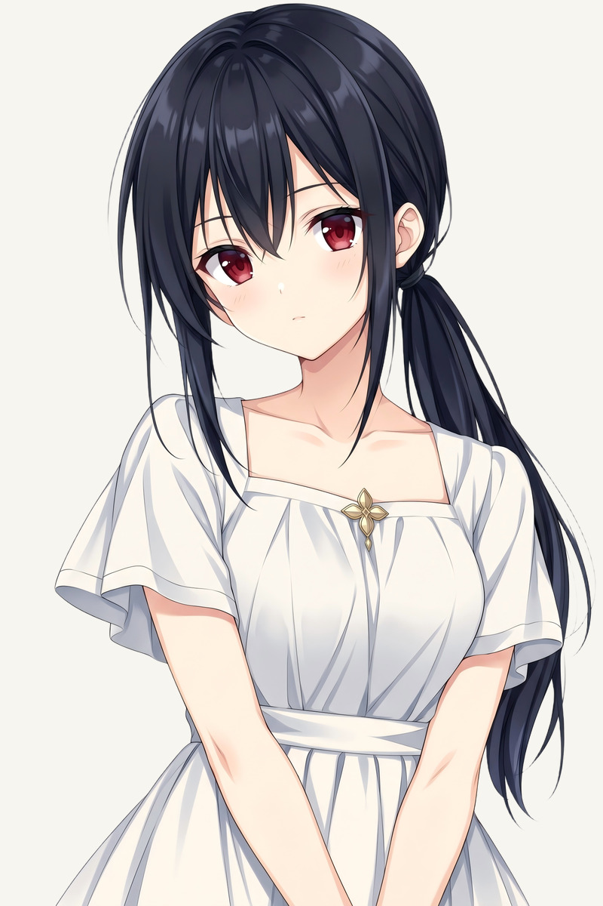
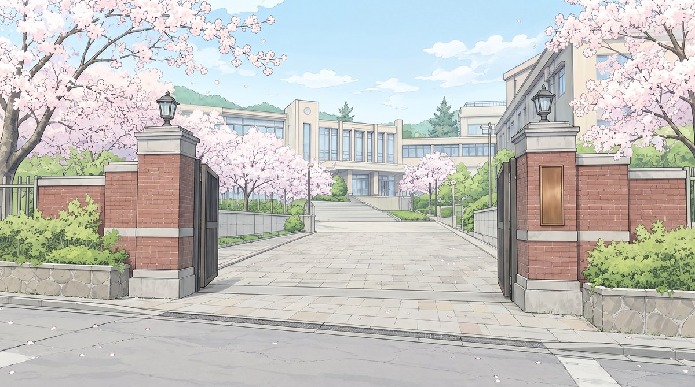
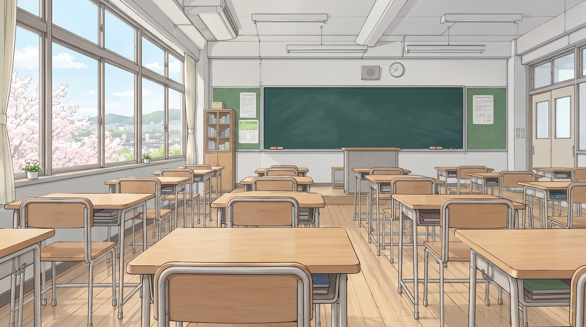
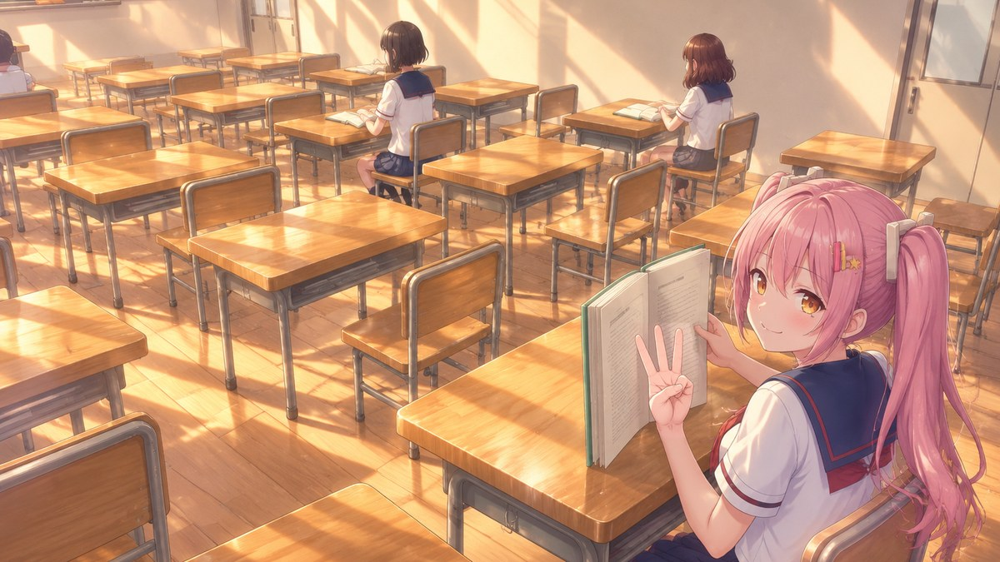
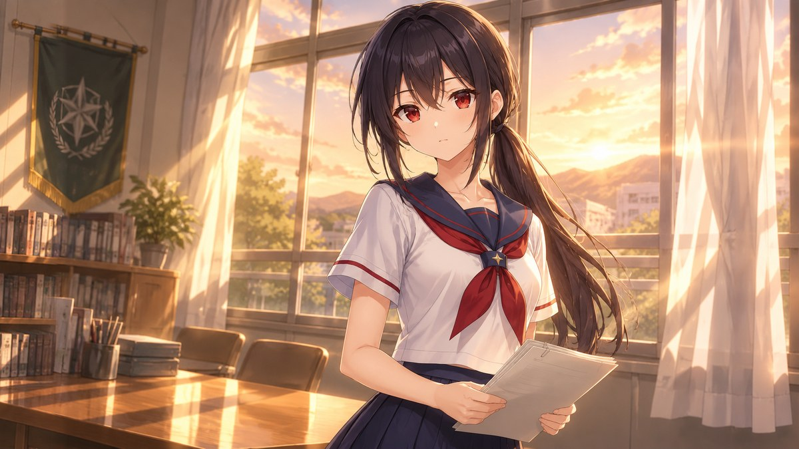
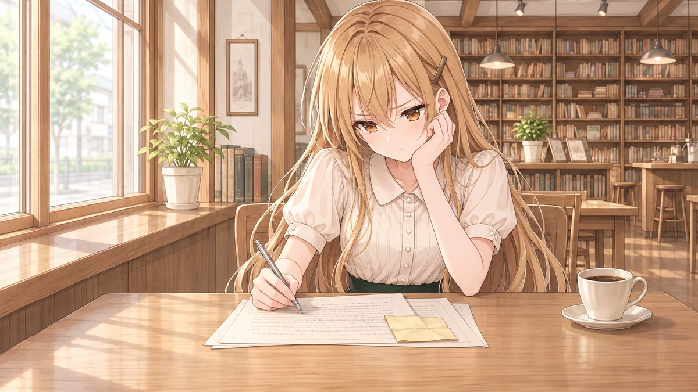
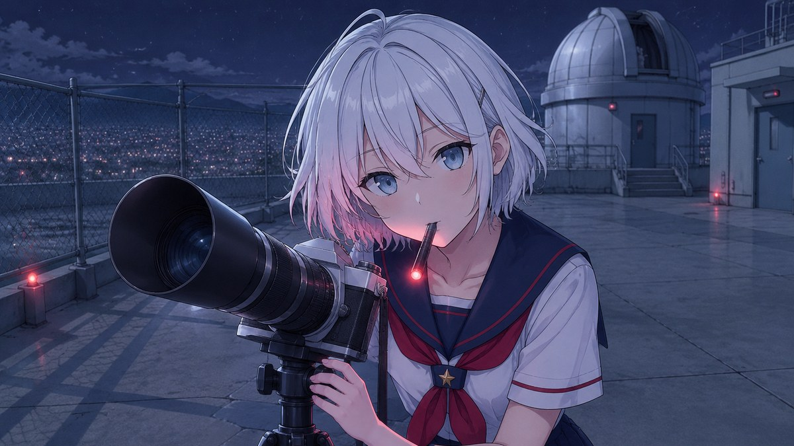

# 作品展示

当前提供四位女主标准立绘、两张背景和四张 CG，共十张展示图。

## 角色立绘

《星屑信》四位女主当前开发版本的标准立绘。点击文件链接可查看展示图。

| [比叡雏](sprites/hina-standard.jpg) | [椿静夜](sprites/shizuya-standard.jpg) | [神崎琉璃](sprites/ruri-standard.jpg) | [雪丸奏](sprites/kanade-standard.jpg) |
| :---: | :---: | :---: | :---: |
|  |  |  |  |

项目作者确认以上四图为原创，使用 image2.5 与 Nano Banana 官方服务交替完成；来源按作者提供的信息登记。

## 背景

| [春日校门](backgrounds/school-gate-morning.jpg) | [晨光教室](backgrounds/classroom-morning.jpg) |
| :---: | :---: |
|  |  |

[背景展示说明](backgrounds/README.md)

## CG

来自《星屑信》`v0.2.1` 正式版的四位女主事件 CG 缩小展示版（均已移除含第一人称主角手部的 CG；其中比叡雏采用新版 MV 覆盖，雪丸奏已于 2026-11-26 完成手部局部修复定版）。

| [比叡雏 · 课桌暗号](cg/hina-classroom.jpg) | [椿静夜 · 风纪统括室](cg/shizuya-council.jpg) |
| :---: | :---: |
|  |  |

| [神崎琉璃 · 豆灯书吧](cg/ruri-mamedou.jpg) | [雪丸奏 · 夜色天台](cg/kanade-rooftop.jpg) |
| :---: | :---: |
|  |  |

[CG 展示说明](cg/README.md)

项目作者确认背景由 image2.5 / Nano Banana 官方服务创作，四张事件 CG 由官方 AI 图像服务（image2.5 / 2.6 / Nano Banana）创作与修补，参考素材有权使用；未逐图划分平台。

以上图片均为缩小的展示版，长边最多 1200 像素。原始制作图、分层文件和完整差分库保持私有。
展示图片不属于 MIT，公开浏览不表示授予独立复用、商用或再发行许可；适用权利范围见 [内容授权说明](../CONTENT_LICENSE.md)。

具体文件和项目确认日期见 [已公开素材登记](../ASSET_REGISTER.md)。
