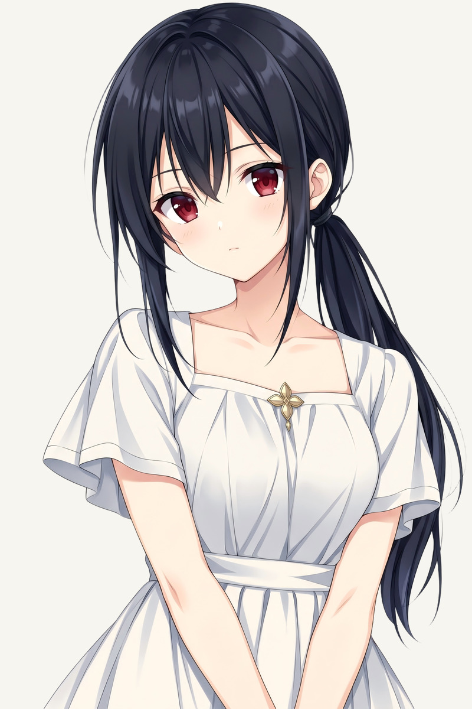
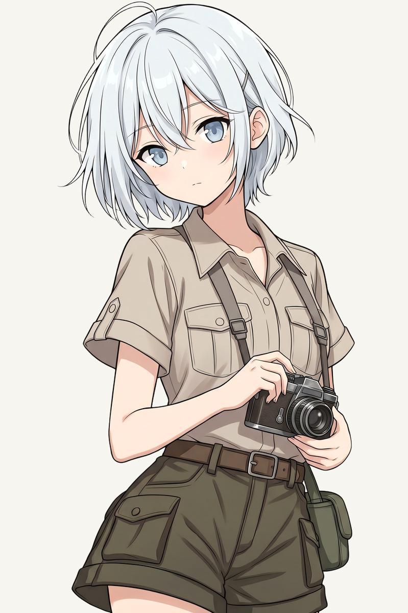
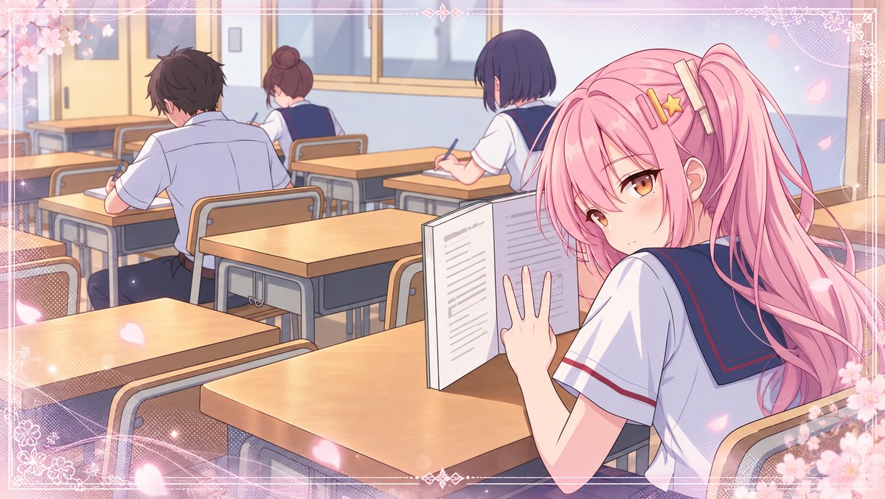

# 作品展示

当前提供四位女主标准立绘、两张背景和一张 CG，共七张展示图。

## 角色立绘

《星屑信》四位女主当前开发版本的标准立绘。点击文件链接可查看展示图。

| [比叡雏](sprites/hina-standard.jpg) | [椿静夜](sprites/shizuya-standard.jpg) | [神崎琉璃](sprites/ruri-standard.jpg) | [雪丸奏](sprites/kanade-standard.jpg) |
| :---: | :---: | :---: | :---: |
|  |  |  |  |

项目作者确认以上四图为原创，使用 image2.5 与 Nano Banana 官方服务交替完成；来源按作者提供的信息登记。

## 背景

| [春日校门](backgrounds/school-gate-morning.jpg) | [晨光教室](backgrounds/classroom-morning.jpg) |
| :---: | :---: |
|  |  |

[背景展示说明](backgrounds/README.md)

## CG

课堂中的一次回望。当前开发版本的比叡雏课堂 CG。

[CG 展示说明](cg/README.md)

项目作者确认背景与 CG 同样由 image2.5 / Nano Banana 官方服务创作，参考素材有权使用；未逐图划分平台。

以上图片均为缩小的展示版，长边最多 1200 像素。原始制作图、分层文件和完整差分库保持私有。
展示图片不属于 MIT，公开浏览不表示授予独立复用、商用或再发行许可；适用权利范围见 [内容授权说明](../CONTENT_LICENSE.md)。

具体文件和项目确认日期见 [已公开素材登记](../ASSET_REGISTER.md)。
