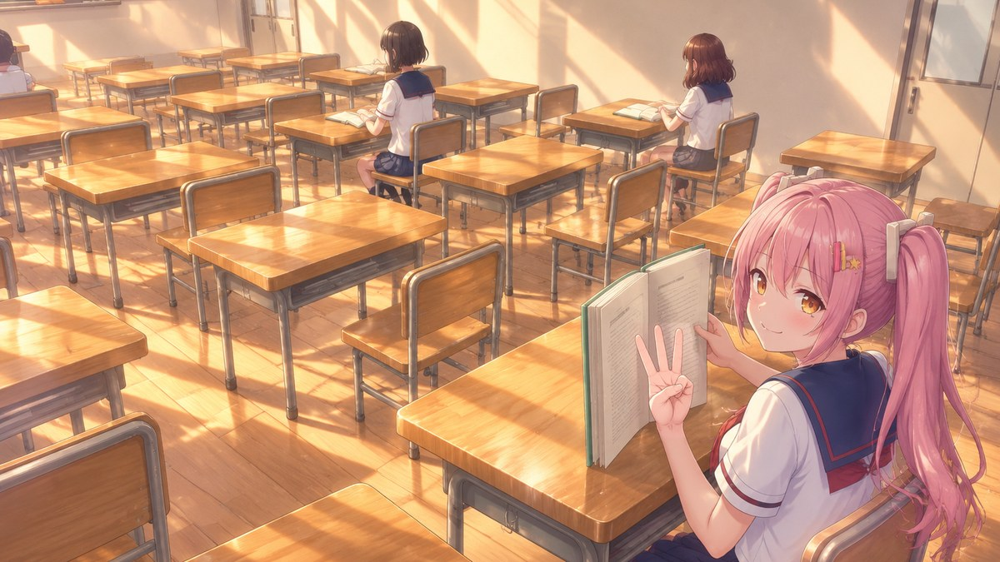
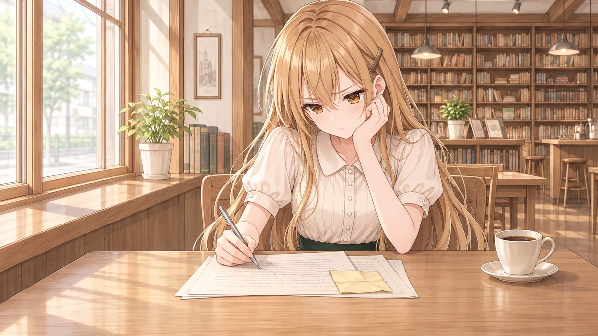
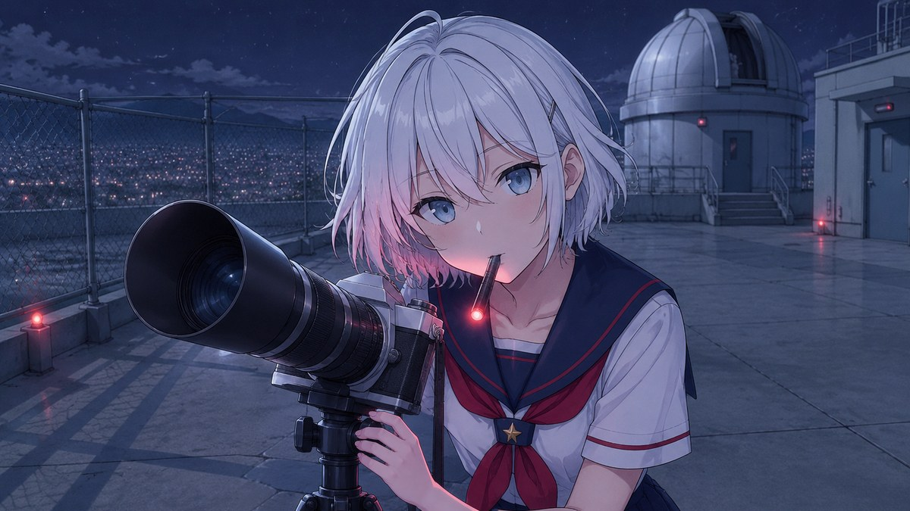

# CG 展示

四位女主各一张事件 CG 缩小展示版（来自 `v0.2.1` 正式版，均已移除含第一人称主角手部的 CG；其中比叡雏采用新版 MV 覆盖，雪丸奏已于 2026-11-26 完成手部局部修复定版）。

| 比叡雏 · 课桌暗号 | 椿静夜 · 风纪统括室 |
| :---: | :---: |
|  |  |

| 神崎琉璃 · 豆灯书吧 | 雪丸奏 · 夜色天台 |
| :---: | :---: |
|  |  |

项目作者确认图片由官方 AI 图像服务（image2.5 / 2.6 / Nano Banana）创作与修补，参考素材有权使用；来源按作者提供的信息登记，未逐图划分平台。

这里提供长边 1200 像素的展示版。图片不属于 MIT，未授予独立复用、商用或再发行许可。权利范围见[内容授权说明](../../CONTENT_LICENSE.md)，具体文件见[素材登记](../../ASSET_REGISTER.md)。

[返回作品展示](../README.md)
